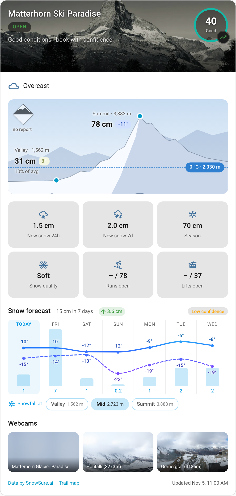
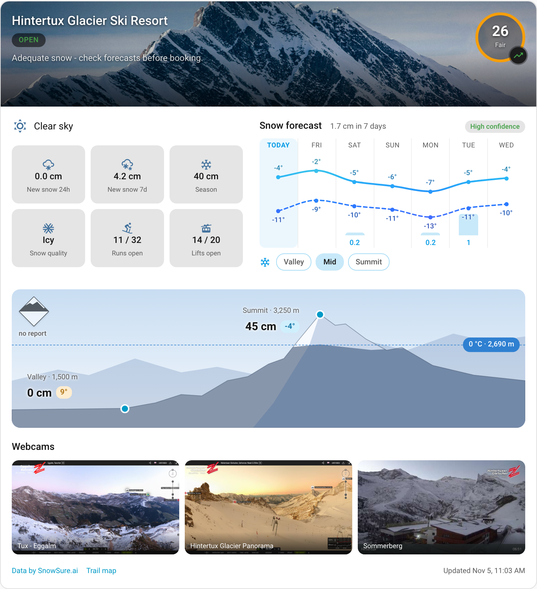
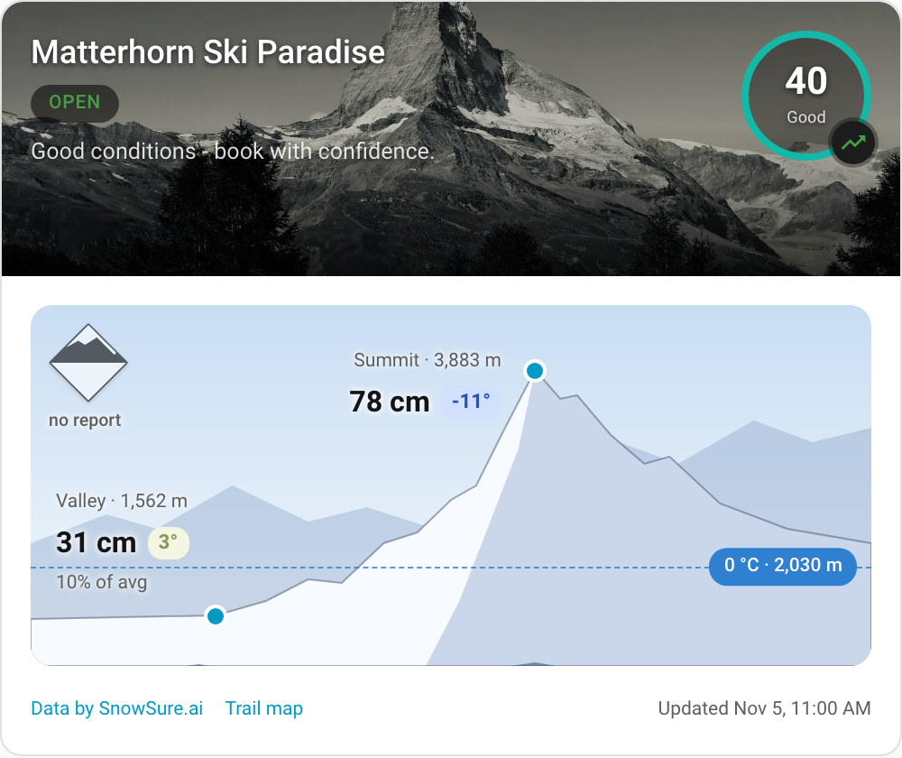
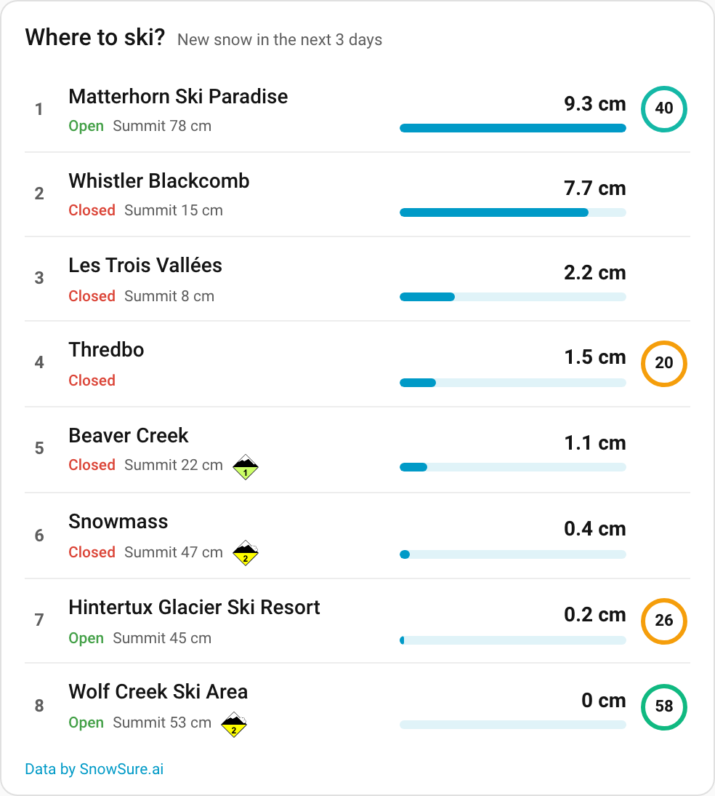

# SnowSure Integration for Home Assistant

[](https://hacs.xyz/docs/faq/custom_repositories/)

[](https://github.com/timmaurice/snowsure/releases)
[](https://github.com/timmaurice/snowsure/commits/main)
[](https://github.com/timmaurice/snowsure)


This custom integration for Home Assistant fetches ski resort data from [SnowSure](https://www.snowsure.ai): snow depth, new snow, a 7-day forecast, the SnowSure score, lifts and runs, and the official avalanche bulletin. **It comes bundled with a Lovelace card** — no separate frontend install needed.



## Features

- **Over 600 resorts worldwide**: Pick a country, then a resort; each resort becomes its own device.
- **Snow at three heights**: Snow depth at valley, mid-mountain and summit, new snow over 24 hours to a week, season snowfall.
- **7-day snow forecast**: Daily snowfall at valley, mid and summit, temperatures and the freezing level (14 days with SnowSure Pro), plus how much the forecast moved since yesterday.
- **Powder alarm and Kaiserwetter**: A binary sensor for enough new snow ahead (threshold, days and height in the options), and one for a clear, dry day after new snow.
- **Weather, calendar and map**: A `weather` entity with a daily forecast for Home Assistant's weather cards, a snow calendar with season dates, powder and Kaiserwetter days, and each resort on the map dashboard.
- **Official avalanche danger**: The level from the regional warning service where a bulletin exists — never guessed when there is none.
- **Webcams and trail maps**: Pick the webcams in the options; trail maps open in a dialog. Pictures load through Home Assistant, so the browser makes no third-party requests.
- **Bundled Lovelace cards**: A resort card with a mountain picture (snow depth, temperatures, 0 °C line, the EAWS avalanche diamond), tiles, a tappable forecast and webcams; a compact variant; and a compare card that ranks several resorts.
- **Localization**: English and German.

## Installation

### Marketplace or HACS (Recommended)

Until this integration is in the default catalog, add it as a custom repository: in HACS, open the menu → **Custom repositories**, enter `https://github.com/timmaurice/snowsure` with the category **Integration**, then install **SnowSure**. The button opens the repository in your Home Assistant:

<a href="https://my.home-assistant.io/redirect/hacs_repository/?owner=timmaurice&repository=snowsure&category=integration" target="_blank" rel="noreferrer noopener"></a>

After installing from HACS, restart Home Assistant.

<details>
<summary>Manual Installation</summary>

1.  Using the tool of your choice, copy the `snowsure` folder from `custom_components` in this repository into your Home Assistant's `custom_components` directory.
2.  Restart Home Assistant.

</details>

The card ships with the integration: it is served from the integration folder and registered as a Lovelace resource automatically (storage-mode dashboards). In YAML-mode dashboards add `/snowsure_frontend/snowsure-card.js` as a `module` resource yourself.

## Configuration

Configuration is done entirely through the Home Assistant UI:

1.  Navigate to **Settings > Devices & Services**.
2.  Click **Add Integration** and search for "SnowSure".
3.  Leave the **API key** empty unless you have SnowSure Pro: the read API is public, and a key only extends the forecast from 7 to 14 days.
4.  Select the **country**, then the **resort**. Each resort is its own entry and device.

Under **Configure** you can change the update interval (default 30 minutes), the powder alarm (threshold, days ahead, height) and the webcams. **Reconfigure** changes the API key.

### Webcams

Resorts list up to a dozen webcams. The options list them all; tick the ones you want. More than three asks for a confirmation, since each one downloads its picture on every update. Only the ticked ones become entities, all enabled, and the card shows them all.

### Powder alarm

On while a day in the look-ahead window forecasts at least the threshold of new snow at the chosen height. Defaults: 15 cm, today and tomorrow, mid-mountain. The attributes name the first such day (`date`, `snowfall`) and the biggest day in the window (`max_snowfall`), so a notification needs no template:

```yaml
triggers:
  - trigger: state
    entity_id: binary_sensor.matterhorn_ski_paradise_powder_alarm
    to: 'on'
actions:
  - action: notify.mobile_app_phone
    data:
      message: >-
        Powder: {{ state_attr(trigger.entity_id, 'snowfall') }} cm
        on {{ state_attr(trigger.entity_id, 'date') }}
```

## Created Sensors

For each configured resort, a device with the following entities is created:

| Entity                                                                                                                                                | Unit     | Enabled by default |
| :---------------------------------------------------------------------------------------------------------------------------------------------------- | :------- | :----------------- |
| Weather (`weather.<resort>`: current conditions and a daily forecast)                                                                                 | weather  | yes                |
| Snow calendar (season start and end, powder and Kaiserwetter days by the powder alarm's threshold and height; texts in the server language)           | calendar | yes                |
| Open (with the resort's coordinates, so it shows on the map dashboard)                                                                                | on/off   | yes                |
| Powder alarm                                                                                                                                          | on/off   | yes                |
| Kaiserwetter, in English Bluebird day (on when a clear, dry day follows ≥ 5 cm new snow within the week; SnowSure's own bluebird predictions join in) | on/off   | yes                |
| SnowSure score                                                                                                                                        | 0–100    | yes                |
| Snow depth valley / summit                                                                                                                            | cm       | yes                |
| Snow depth mid-mountain                                                                                                                               | cm       | no                 |
| New snow 24h / 7 days, season snowfall                                                                                                                | cm       | yes                |
| New snow 48h / 72h                                                                                                                                    | cm       | no                 |
| Snow forecast 7 days (attributes `daily`, `change_24h`, `change_48h`: change since the run a day / two days ago)                                      | cm       | yes                |
| Snow forecast 14 days (Pro only)                                                                                                                      | cm       | no                 |
| Lifts open / runs open (attribute `total`)                                                                                                            | –        | yes                |
| Terrain open                                                                                                                                          | %        | no                 |
| Temperature valley / summit                                                                                                                           | °C       | yes                |
| Temperature mid-mountain                                                                                                                              | °C       | no                 |
| Weather text, snow quality (from SnowSure's snowpack model where it shares it, attribute `source`; else the resort report)                            | text     | yes                |
| Avalanche danger level (1–5)                                                                                                                          | –        | yes                |
| Forecast confidence (low / medium / high)                                                                                                             | –        | yes                |
| Resort image                                                                                                                                          | image    | yes                |
| Webcam _name_ (picked in the options; default the first three)                                                                                        | image    | yes                |
| Trail map _name_                                                                                                                                      | image    | yes                |
| Season opening / closing, last updated                                                                                                                | date     | yes (diagnostic)   |

`unknown` means SnowSure has no value — for example no lift report, or no current avalanche bulletin. A missing bulletin is never a low danger rating.

## Lovelace Card

```yaml
type: custom:snowsure-card
device: <device id of the resort> # picked in the visual editor
title: Zermatt # optional
compact: false # true: header and mountain only, for small dashboards
show_score: true
show_image: true # resort photo as header background
show_weather: true
show_mountain: true # mountain with snow depth, temperature, 0 °C line and the avalanche diamond
show_stats: true
stats: # tiles, in this order
  - depth_base
  - depth_summit
  - snowfall_24h
  - snowfall_7d
  - snowfall_season
  - snow_quality
  - runs_open
  - lifts_open
show_forecast: true
forecast_days: 7 # 1–14
forecast_band: mid # base, mid or summit; unset = SnowSure's forecast point
show_avalanche: true
show_webcams: true # the webcams picked in the integration options
```

Available tiles: `depth_base`, `depth_mid`, `depth_summit`, `snowfall_24h`, `snowfall_7d`, `snowfall_season`, `forecast_7d`, `runs_open`, `lifts_open`, `temperature_base`, `temperature_summit`, `snow_quality`. Everything can be set in the visual editor, and the card is offered in the card picker for SnowSure entities.

### Layouts

The card follows its own width, and a compact variant and a compare card sit next to it:

| Wide (a section spanning two columns)                                                                                                                                                                                                                                                                                           | Slim (one column)                                                                                                                                                        |
| :------------------------------------------------------------------------------------------------------------------------------------------------------------------------------------------------------------------------------------------------------------------------------------------------------------------------------ | :----------------------------------------------------------------------------------------------------------------------------------------------------------------------- |
|  |  |

| Compact (`compact: true`)                                                                                                                                 | Compare card                                                                                                                                                                                                                                        |
| :-------------------------------------------------------------------------------------------------------------------------------------------------------- | :-------------------------------------------------------------------------------------------------------------------------------------------------------------------------------------------------------------------------------------------------- |
|  |  |

### Card Features

- **The mountain**: Snow depth and temperature at valley and summit, the 0 °C line from those temperatures, and the avalanche danger as the EAWS diamond. It replaces the depth tiles and the temperatures in the weather row.
- **A day on the mountain**: Tapping a day in the forecast shows that day on the mountain: new snow at valley, mid and summit, SnowSure's freezing level for the day and its temperatures. Tap it again, or the date badge, to go back to now.
- **Snowfall at three heights**: SnowSure's daily forecast is for one point, usually mid-mountain. The switch under the bars shows valley, mid or summit, each with its height; `forecast_band` picks where it starts. SnowSure has one temperature series only, so the temperature lines stay.
- **Kaiserwetter**: Days from the integration's sensor get a sun and a golden column in the forecast, a chip in the header for today or tomorrow, and a blue sky when picked on the mountain.
- **Forecast trend**: An arrow beside the forecast total shows how the 7-day forecast moved since yesterday.
- **Trail maps**: The trail map opens in a dialog over the dashboard; ctrl/cmd-click opens it in a new tab. Android's WebView, and so the companion app, cannot show PDFs inline — use the new-tab button there.
- **Follows its width**: In a normal section column everything stacks; from 640 px (a section spanning two columns, or a panel view) it switches to two columns with the mountain as a panorama below.

### Compare Card

`custom:snowsure-compare-card` ranks several resorts side by side: new snow over the next days (or SnowSure score, or summit depth), with open/closed, summit depth, avalanche level and score per row. A tap opens the resort's forecast.

```yaml
type: custom:snowsure-compare-card
title: Where to ski? # optional
devices: [] # optional: SnowSure resorts, empty = all
sort: snowfall # snowfall, score or depth
days: 3 # days of new snow added up, from today
band: summit # optional: base, mid or summit; unset = each resort's forecast point
```

## Data Source

All data comes from the [SnowSure](https://www.snowsure.ai) public API and is shown with the credit "Data by SnowSure.ai", as SnowSure's terms require.

## Development

<details>
<summary>To contribute to the development, you'll need to set up a build environment.</summary>

1.  **Clone the repository:**

    ```bash
    git clone https://github.com/timmaurice/snowsure.git
    cd snowsure
    ```

2.  **Install dependencies:**

    ```bash
    pip install .[dev]
    npm ci
    ```

3.  **Run the backend tests:**

    ```bash
    PYTHONPATH=. pytest tests
    ruff check . && ruff format --check .
    ```

4.  **Build and test the frontend card:**
    This compiles `frontend/src/snowsure-card.ts` into `custom_components/snowsure/snowsure-card.js`, which is committed: the integration serves it and registers it as a Lovelace resource.

    ```bash
    npm run build
    npm run lint && npm run check-format && npm test
    ```

### Local Testing with Docker

To test your changes against a real Home Assistant instance without touching your production setup:

1.  Run `docker compose up -d` to start a local Home Assistant container with this integration mounted.
2.  Access Home Assistant at [http://localhost:8138](http://localhost:8138) (login `admin` / `password`) and complete onboarding if this is the first run.
3.  Add the "SnowSure" integration and the `snowsure-card` to a dashboard to verify your changes.
4.  After editing Python files under `custom_components/snowsure/`, run `docker restart ha-snowsure-test` to pick up the changes (no rebuild needed).
5.  After editing frontend files, run `npm run build` first, then restart the container the same way.

The container sets `SNOWSURE_DEMO=1`: the resort list then also offers **Kaiserberg (Demo)** (country "Demo"), a made-up resort answered locally by `custom_components/snowsure/demo.py`. Its dates follow today, so every case stays visible: powder alarm today, Kaiserwetter tomorrow, avalanche level 4, forecast trend and snowpack snow quality. Never set the variable outside development.

`npm run test:e2e` runs the Playwright suite in `test/e2e` against that container, on dashboards of its own; it uses the demo resort. Run `npx playwright install chromium` once before the first run.

When you're done, run `docker compose down` to stop the environment. Your configuration persists in the `test_config/` folder between runs.

</details>

## Credits

Data by [SnowSure.ai](https://www.snowsure.ai). Avalanche danger icons by the [European Avalanche Warning Services (EAWS)](https://www.avalanches.org/downloads/), with colour and number in the lower half as on [lawinen.report](https://lawinen.report/education/danger-scale).

## Contributions

Contributions are welcome! If you find a bug or have a feature request, please open an issue on the GitHub repository.

<details>
<summary>Contributing Translations</summary>

This repo has two separate translation sets, both need updating for a new language:

1.  **Integration** (config flow, entity names): in `custom_components/snowsure/translations`, copy `en.json` and rename it to your language code (e.g., `fr.json` for French). Home Assistant picks up new translation files automatically — no code changes needed.
2.  **Lovelace card** (editor, card UI): in `frontend/src/translation`, copy `en.json` and rename it to your language code, then import the new file in `frontend/src/localize.ts` and add it to the `translations` object.

Translate all the values in both new files and submit a pull request with your changes.

</details>

---

For further assistance or to [report issues](https://github.com/timmaurice/snowsure/issues), please visit the [GitHub repository](https://github.com/timmaurice/snowsure).

## ☕ Support My Work

[](https://www.buymeacoffee.com/timmaurice)
